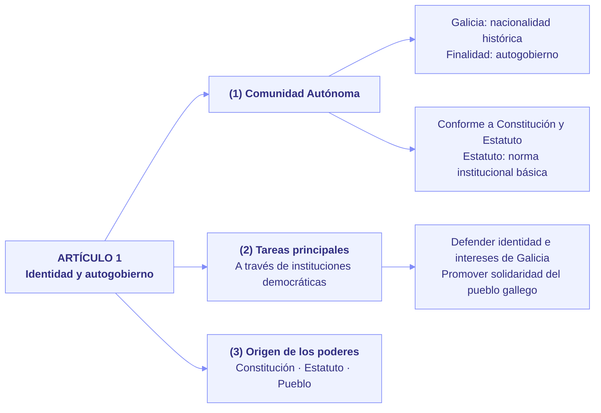
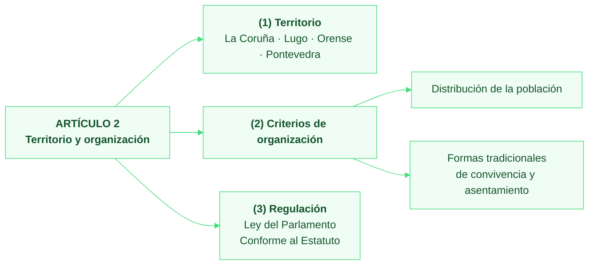

```mermaid
---
config:
  theme: base
  themeVariables:
    primaryColor: '#f5f3ff'
    primaryBorderColor: '#a78bfa'
    primaryTextColor: '#4c1d95'
    lineColor: '#a78bfa'
---
flowchart LR
    H["<b>ARTÍCULO 3<br/>Condición política de gallego</b>"]
    H --> A["<b>(1) Condición política</b>"]
    A --> A1["Ciudadanía española + vecindad administrativa<br/>en un municipio gallego<br/>Según las leyes generales del Estado"]
    H --> B["<b>(2) Derechos políticos en el exterior</b>"]
    B --> B1["<b>Españoles residentes en el extranjero</b><br/>Última vecindad administrativa en Galicia<br/>Acreditación en el Consulado de España"]
    B --> B2["<b>Sus descendientes</b><br/>Inscritos como españoles + solicitud<br/>Según la ley del Estado"]

---

config:
  theme: base
  themeVariables:
    primaryColor: '#fff7ed'
    primaryBorderColor: '#fb923c'
    primaryTextColor: '#7c2d12'
    lineColor: '#fb923c'
---
flowchart LR
    H["<b>ARTÍCULO 4<br/>Derechos e igualdad efectiva</b>"]
    H --> A["<b>(1) Derechos, libertades y deberes</b><br/>Los establecidos en la Constitución"]
    H --> B["<b>(2) Deberes de los poderes públicos</b>"]
    B --> B1["Promover libertad e igualdad reales y efectivas<br/>De individuos y grupos"]
    B --> B2["Eliminar obstáculos que las impidan o dificulten"]
    B --> B3["Facilitar la participación de todos los gallegos<br/>Política · Económica · Cultural · Social"]
    H --> C["<b>(3) Principio rector social y económico</b><br/>Derecho a vivir y trabajar en Galicia"]
```
```mermaid
```
```mermaid
```
```mermaid
```
```mermaid
```
```mermaid
```
```mermaid
```